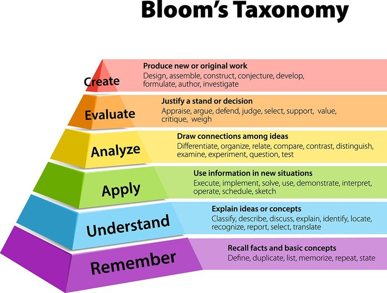

# Reflections

This document contains the thinking behind tamebubu: questions I worked through, options I'm weighing, and why the current answer is whatever it is.
Specs.md describes the architecture as decided; this file is more of a thinking scratchpad where I debate and document decisions.

Each entry has a status + last updated date:

- **Decided**: settled; change when there is new evidence
- **Leaning**: current direction, not final
- **Open**: no answer
- **Rejected**: considered and dropped

---

## The core claim

**Status:** Decided
LAST EDITED : 10/18/26

Spaced repetition works for facts: spacing study over time and testing oneself improves long-term retention.[^cepeda2008][^roediger2006][^adesope2017]
But the effect isn't limited to simply recalling atomic "facts". Spacing has been shown to help with math practice in real classrooms.[^barzagar2019]
Furthermore, beyond spacing, "interleaved practice" has been shown to be effective.[^rohrer2007][^taylor2010] Interleaving means mixing different problem types in one session instead of doing a block of one type, so for each problem you have to pick the right method, not just repeat. It's a separate effect from spacing: with spacing held constant, interleaving lowered scores during practice **but roughly doubled them on a test the next day**, and the error analysis suggests it helped students match each problem to the right procedure.[^taylor2010] Retrieval practice also transfers beyond the exact questions practiced.[^pan2018]

At the core we are trying to develop something which applies the same principles used by traditional SRS programs(like Anki, Supermemo and Remnote) on declarative knowledge, onto "practice" and "skill acquisition". 

This is from the bold assumption that "skills" are also in fact features of long-term memory that decay without practice,[^arthur1998] and that practice of said skills can be scheduled to optimize both retention and mastery.

That way one can do less practice and get more results (potentially) than cramming all day and doing blind, repetitive practice.

Tamebubu aims to do it by scheduling the learner's error patterns (gaps) instead of cards or topics. Closest to this model is the DAS3H knowledge-tracing model, which does not focus on "gaps" but on the spaced practice of "skills" through exercises.[^choffin2019] Scheduling errors rather than topics rests on the idea that procedural errors are systematic rather than random: students' bugs can be modeled as small edits to correct procedures, and those models can predict future mistakes.[^brown1978][^vanlehn1990]

According to VanLehn, there are three phases of cognitive skill acquisition:[^vanlehn1996]

1. Encoding the principles
2. Solving problems, which covers two things:
   1. Learning to solve problems
   2. Repairing knowledge gaps while solving the problem
3. Automation

Tamebubu lives in the 2nd part of the 2nd phase: "repairing knowledge gaps". 
"Repairing knowledge gaps" is perhaps the most tedious part of this process, as one has to:
1. Practice problems until one that exposes a gap is encountered.
2. Then:
   1. Understand and remediate the gap.
   2. Practice MORE problems to see if you will repeat this gap in a dissimilar context (as sometimes, you may have developed "automation" for a specific problem class without actually fixing the gap in your encoding; I call that "blind automation": reaching phase 3 before finishing phase 2).

The process of going through exercises after exercises to find gaps, to test gaps, to retest gaps, etc... can take a very long time. And a lot of that time is wasted. In one study, 9 practice problems instead of 3 in one session did nothing for scores one and four weeks later,[^rohrer2006] in another study, cutting over-practice in a geometry tutor saved time without hurting learning,[^cen2007] and in real tutor data students keep grinding skills they already mastered.[^xia2025] Finding a gap isn't a one-exercise job either: students "shift back and forth among bugs", because the same underlying gap shows up as different errors depending on how they patch it in the moment.[^vanlehn1990]

Aside : There are multiple hypothesises for some of these problems.

First of all, identifying one's gap is pretty "hard", cognitively. It takes mental power. Students may not want to reflect on their error because that requires mental energy.
Secondly, the advice of "just practicing". People tend to think intuition is developed over time by bruteforcing through high volume repetitions. "Just practice and then it will click". This promotes passive learning and little reflection.
Third, people have egos. You might practice problems you have already mastered to get a sense of accomplishment and reward, and avoid areas where you are weak to avoid facing your weaknesses and feel "lesser". This may be conscious or unconscious. This begs the question : is it actually a good thing to do problems in topics you have already mastered to develop a sense of confidence and "reward" yourself, for moreso psychological reasons? It may be the case, but that does not equal to better learning and over-reliance on this validation may delay the consolidation of crucial gaps. We will discuss "exercise types" later and see that some types of exercises may more useful to repeat even after mastery than others, "skill drills". That way one can repeat things and develop confidence without wasting too much time.

Usually, people optimize for this by using their "intuition" and "weak topics". But intuition is a bad guide here: students tend to misjudge what they know,[^koriat2005][^karpicke2008] drop material they feel they know even when they never once recalled it for real, and mostly just study whatever is due the soonest.[^kornell2007] And "topics" are mostly surface: for example, novices tend to group physics problems by surface features (inclined planes, springs) while experts tend to group them by the principle that solves them (conservation of energy).[^chi1981] That's literally how blind automation happens: you learn the surface category, not the principle. The principle and the relationships are often more important than the atomic surface level categories. On top of that, practicing one topic at a time is **blocked practice**, which loses to interleaving.[^taylor2010]

The bigger problem with practicing based on topics is that gaps are not always topic-bound; in fact, often gaps are intertopic, as they tend to expose a misunderstanding in how different elements work together rather than in isolation. The evidence for this is indirect for now: problems that combine skills are harder than their parts predict (the composition effect, though it was found inside algebra word problems),[^heffernan1997] what makes material hard is elements that have to be processed together (element interactivity),[^sweller1994] and a common math error is confusing similar problem types, which practicing one topic at a time makes worse.[^rohrer2012] I haven't found anything that measures what share of errors actually cross topic boundaries. So for now it's a hypothesis boldly and unscientifically based on my own experience: the unit people practice by (chapter, topic) isn't the unit their errors happen at. 
Tamebubu can test it: does a gap-level model predict errors better than a topic-level one, and how many promoted gaps carry high q-weights across more than one topic?

At the core we are not trying to make a calculus review program, an electric circuit analysis review program, a notebook program, a high school math review program.
The scope is practice only.

Much of Tamebubu was influenced by Cognitive Load Theory and [research on self-regulated learning](https://www.ahmni.app/blog/literature-review-self-regulation/), which I was exposed too thanks to Dr. Justin Sung and the ICanStudy program. Regarding scheduling practice, Dr. Sung concludes, "specific guidelines on exact scheduling cannot be made".[^sung2022]
No universal schedule exists, so it has to be fitted per learner from data.
And this is precisely why software is needed here. Similarly, in the context of flashcards with Anki, universal schedule rules cannot be made, hence FSRS was developed.

---

## Learner model, scheduler and gap registry are three components

**Status:** Decided

One problem I had is that the difference between the learner's model, the scheduler and the gap registry wasn't clear.
Learner's model is an heritage from DAS3H, but in DAS3H the scheduler, or at least the user memory model, is PART of the learner's model.
Meanwhile something like FSRS ships its memory model and its interval policy in one library. But these answer three different questions:

| Component | Question it answers | What it holds |
| --- | --- | --- |
| Gap registry | What gaps exist? | Gaps, their descriptions and evidence spans, the Q-matrix |
| Learner model | How weak is this learner on each gap, now and later? | Per-learner state per gap ID, fitted weights |
| Scheduler | What is due, and when? | A policy: target rate, daily cap, randomized arm |

Analogy: the registry is the map, the learner model is where you are and where you're weak, the scheduler is the route planner.

The DAS3H paper frames the scheduling problem (Section 3) and builds the learner model it needs.[^choffin2019] The threshold policy itself comes from flashcard research, where reviewing the item closest to being forgotten was close to optimal[^lindsey2014][^khajah2014] and fits the idea of "desirable difficulties".[^bjork1994] Reviewing too early can hurt long-term retention,[^cepeda2008] which is why the scheduler gotta wait for the threshold instead of reviewing everything often.

Separating them lets me swap the policy without touching the model, and the model (e.g. FSRS) without touching the policy.

---

## Scheduler vs. practice planner

**Status:** Decided

The scheduler decides which gaps are due.
The practice planner decides what you do about them. Why split them? Because there are different strategies towards gap remediation.
You may schedule gaps but the practice to be done from that gap is another thing entirely.

One gap can be remedied by many kinds of activity, and choosing among them is a problem in and of itself.

| Activity | When it fits | Notes |
| --- | --- | --- |
| Bank exercise | Default | Pick by Q-matrix weight |
| Variant (same problem, swapped values) | You've seen the original too recently, or are memorizing it | SymPy computes the new answer |
| Author your own | After a reflected failure, once a gap is named | Strong Q-matrix prior, since it was written for that gap |
| Fact card | Cause was a forgotten theorem or definition | Closer to a flashcard than a problem |
| Integrative problem | Cause was poorly understanding how two techniques combine | Needs high weight on both gaps |
| Least-similar trigger | Gap looks stable; test transfer | The similar-vs-dissimilar rule below |
| Worked example | Fresh gap on material one barely knows | Addresses the expertise reversal effect[^kalyuga2001] |

**Variants** are what educational software from Pearson/WebAssign already does with parametric templates. They prevent "blind automation" of the answer: the numbers change, so you can't just remember the result. 

**Least-similar triggers** catch the blind automation variants can't. Sometimes the gap may look stable after many variant activities, but the user may have simply memorized the specific algorithm for this specific shape of problem. So a nice interleaving technique is to schedule the problem least similar in shape that still triggers that same gap. Variants stop you memorizing the answer; least-similar triggers stop you memorizing **the shape**.

**Authoring your own:** the learner crafts their own exercise, modeled after the gap they discovered, and schedules it for later. This is a learning event in itself, like reflection; producing material yourself is remembered better than reading it (the generation effect).[^slamecka1978] For complex material, studying a worked example can even beat generating,[^chen2015] so authoring suits gaps you half-understand rather than brand-new ones.

At different stages of learning, different activities become more suited (see Difficulty / Type of "Practice" below).

Consequences:
- The scheduler's output carries the cause/source exercise for the gap, not just a gap ID, or the planner can't choose between a fact card and a variant.
- What helps depends on how far along you are: worked examples beat problem solving for novices, and the advantage reverses as expertise grows (this is called the expertise reversal effect).[^kalyuga2001] A fresh gap on material one barely knows may need a worked example before a problem, which brushes against the practice-only scope.
- Each attempt records its activity type. Variants share a family ID with their source; self-authored items are tagged, since you knew the target and they'll be easier.

For example, assuming a target success rate of 80%:

1. The scheduler asks the learner model for each gap's predicted success now (chain rule 0.71, supernode 0.93, branch bookkeeping 0.78).
2. Chain rule and branch bookkeeping are below 0.8, so they're due.
3. The planner reads the Q-matrix to find exercises that expose both, picks the smallest set that covers them, skips anything seen yesterday, and applies the distance rule.

---

## Difficulty / Type of "Practice"

**Status:** Leaning

Types:
- A **skill drill** is an isolated drill that is easy to drill in a certain skill or technique, which is often algorithmic. They typically last very short times.
- An **exercise** is more integrative but still atomic since it focuses on 1-2 concepts.
- A **problem** is more integrative.
- A **challenge/application/project** is even more integrative.

So when doing spaced retrieval for exercises, scheduling a skill drill can be done much more times than scheduling a more integrative problem that really requires you to manipulate different concepts, understand how they relate, and go through more steps.

Then there's "order", and by order I refer to Bloom's taxonomy.

Some exercises are about simple recall, while other exercises are about integrative recall, while other exercises are about reconstruction, and other exercises are about integrative applications leading to a new creation.

We can describe here three dimensions:
| Dimension | Range | Where it comes from |
| --- | --- | --- |
| Integration | drill -> exercise -> problem -> challenge | Mostly the Q-matrix: a drill has high q on one gap, a problem on several. Book position and LLM labels are priors until it fills in |
| Time cost | seconds -> hours | Estimated at first, then the logged time per attempt |
| Order (Bloom's) | recall -> application -> creation | LLM label potentially; the hardest to judge, so lowest priority |

How each component uses it:

**Practice planner: type follows maturity.** Sometimes you have to learn in isolation before applying in relation. Gaps being revealed often intertopic does not mean you can't practice the gap in isolation first and then intertopic, depending on maturity.
This is the isolated-interacting elements effect: processing the elements one at a time first, then all together, produced better learning than getting everything at once.[^pollock2002] It's in the same family as the expertise reversal effect for worked examples.[^kalyuga2001]

| Stage | Practice |
| --- | --- |
| Fresh, material barely known | Worked example, or a drill on the isolated piece |
| Fresh -> Consolidating | Faded example; exercise (1-2 concepts) |
| Consolidating | Problem |
| Stable | Integrative problem or challenge; least-similar trigger |

Integration and probe distance are separate axes. Distance is how different an exercise looks from where the gap was found; integration is how many things it combines. Which also means it's not enough to track which gap the user got; one needs to track on which exercises, too (see the origin set below).

**Scheduler: time cost turns scheduling into a budget.** Skill drills are just small; you can have a variety of small drills that you can do while walking or something. So session length is an input: five minutes walking means drills; two hours means one integrative problem that covers several due gaps. That's why a skill drill can be scheduled way more times: drills are cheap, problems are expensive but cover many gaps at once. The scheduler needs each exercise's cost and coverage, not a frequency rule per type.

**Learner model: evidence quality depends on type.** A failed drill blames one gap cleanly. A failed problem spreads blame across several (attributed counting), so each gap gets weaker evidence. Drills diagnose; problems test integration. Worked examples give no evidence at all (although they give exposure).
As such, "drills" can also server as a way to "test out" potential gap sources. This can be implicit. If the user fails at one exercise and there are already potential gaps in the database associated with it, then it will schedule easier, faster, more atomic exercises related to individual gaps to update the model.

The catch though: drills risk blind automation, and so do worked examples. But they help beginners. Both are scaffolding: the planner moves a gap off them as it matures instead of piling problems on top. Staying on one drill type too long is also blocked practice, which loses to interleaving.[^taylor2010]

---

## FSRS on gap tags

**Status:** Rejected as the core; kept as the day-one baseline

The first plan was to run FSRS with each gap tag as a card. But then I decided to drop that shit.

The DSR model (Difficulty, Stability, and Retrievability) might simply not be useful for my purposes here, for 3 reasons:

1. **Different causes, same wrong answer.** Take circuit practice. I might forget what KCL says. Remember KCL but fail to recognize a supernode. Identify the supernode correctly but omit an external branch. Set everything up correctly and make an algebra mistake. All four produce an incorrect answer, and they call for different follow-up activities.
2. **Difficulty isn't forgetting.** If I succeed on a simple exercise and fail on a harder exercise carrying the same tag, that change might reflect task difficulty or context rather than forgetting.
3. **The harnesses differ by domain.** The abstractions we use to evaluate the patterns, data, responses, etc. (the "harnesses"), and how we update future scheduling and evaluate what we need to schedule in the future, differ. Not the abstract act of rescheduling, but the harnesses around it. And with a hacky tag-based FSRS it's much harder to adapt to different situations.

If most of the important decisions require machinery outside DSR, DSR may not deserve to organize the whole system.

---

## The learner model: a DAS3H variant

**Status:** Leaning

I guess what we want is to do BKT on emergent skill/gap maps with optimizations for scheduling like DAS3H. DAS3H already addresses scheduling not being part of BKT, but not the emergent capability/gaps thing. Which would be an innovation.

Options weighed:

- **BKT**[^corbett1994]: binary hidden state per skill with learn, guess and slip parameters. No native forgetting, and each new skill needs its own fitted parameters. Merging two emergent gaps would mean re-estimating.
- **DAS3H**[^choffin2019]: logistic regression on learner ability, item difficulty, skill easiness, and windowed counts of past wins and attempts per skill. It extends DASH,[^lindsey2014] which had the time windows but one skill per item, and the additive factor models it descends from.[^pavlik2009] Forgetting comes from the time windows. A new gap is just new feature columns starting at the average; merging two gaps sums their histories.
- **Deep knowledge tracing**[^piech2015]: learns latent concepts but isn't interpretable, and needs far more data than one learner has. Simpler models with good features have matched it on standard benchmarks.[^wilson2016] Its core idea survives in my design though: let some gaps stay latent (e.g. when the user doesn't provide work or reflection), found statistically before anyone can name them, and use reflection to name them later. That's the bottom-up half of the Q-matrix (see The Q-matrix from two directions), done with factorization instead of a neural network so it stays interpretable and works on small data.

DAS3H wins for this design. Its ablations say embeddings barely help (dimension 0 is enough, so it's scikit-learn; the embedding version runs on Knowledge Tracing Machines[^vie2019]), time windows matter most, and per-skill forgetting matters too.

My three changes:

1. **Fractional q:** each gap's terms are weighted by q in [0, 1] instead of 0 or 1.
2. **Attributed counting:** a failure counts against the gap it was attributed to, not every gap on the item. A slip gives every exposed gap a win. Invisible in the equation; it lives in the data pipeline.
3. **Reflection term:** a third windowed count of reflected failures. If its weight comes out positive, reflecting helps.

### Time windows

**Status:** Leaning

DAS3H counts wins in fixed windows (1 hour, 1 day, 7 days, 30 days, all time), taken from DASH.[^lindsey2014]

But I don't really like time windows being static hour, day, week, month. I feel like it should be as customizable and adaptable as with Anki/FSRS.

The concrete problem is that a win falls off a cliff when it leaves a window, while real forgetting fades progressively and not on some discrete square wave shit. The fix is to treat each window as a kernel and replace the box with a smooth decay whose time constants are learned, **the same way FSRS fits its parameters to a learner's review history**.[^ye2022] Half-life regression does something similar for vocabulary, predicting a decay rate from features.[^settles2016] Box kernels at those five widths recover DAS3H exactly, so this generalizes the thing.

### Data for one learner

**Status:** Decided

One semester is roughly 500 to 2,000 attempts.
Public logs (PSLC DataShop; KDD Cup 2010[^stamper2010]; ASSISTments[^feng2009]) can supply population priors for the forgetting dynamics, but not the gaps themselves unfortunately.
Synthetic students test the pipeline but can't teach a forgetting curve, since the curve is what they'd be simulated from.

Datasets:

- [MathNet](https://mathnet.mit.edu/)
- [MathDial](https://huggingface.co/datasets/eth-nlped/mathdial)[^macina2023]: "MathDial is grounded in math word problems as well as student confusions which provide a challenging testbed for creating faithful and equitable dialogue tutoring models able to reason over complex information. Current models achieve high accuracy in solving such problems but they fail in the task of teaching." Careful: the "students" are an LLM, so the confusions are an LLM's errors, not real students'.
- [TutoringDialogs](https://huggingface.co/datasets/ptvnck/TutoringDialogs)
- [ScratchMath](https://bbsngg.github.io/ScratchMath/)[^song2026]: real handwritten scratchwork from real students, with expert error labels.
- [DrawEduMath](https://drawedumath.org/) Similar as above.
- [Mendeley digitized examination-papers dataset](https://data.mendeley.com/datasets/sf3kvjwknt/1)
- [CHECK-MAT](https://huggingface.co/papers/2507.22958)
- [Student Proof by Induction Data Set](https://dataverse.harvard.edu/dataset.xhtml?persistentId=doi:10.7910/DVN/OTRLXF)
- [Student Messy Handwritten Dataset (SMHD)](https://huggingface.co/datasets/marfberg/Student-Messy-Handwritten-Dataset)

Behind wall/restricted:

- [NAEP 2017 and 2019 math student responses, grades 4 and 8 (restricted use)](https://nces.ed.gov/use-work/dataset/naep-2017-and-2019-national-mathematics-student-responses-grades-4-and-8-restricted-use-data-files)
- [NAEP math automated scoring challenge](https://github.com/NAEP-AS-Challenge/math-prediction#eligibility)

---

## Hand-written taxonomy vs. emergent gaps

**Status:** Decided: hybrid

Problems with a hand-written / expert taxonomy:
- expensive
- time consuming to develop
- cannot possibly describe every "gap" nor skill

I started out fully emergent. The whole point of this idea is that gaps are emergent rather than pre-written.

Why expert maps aren't enough on their own: when you study a procedural subject, while doing your exercises you discover procedural gaps that you could then describe vocally but that you would NEVER find described in a textbook. Sometimes professors even mention these gaps out loud while "helping" you or during lectures. It's like there are always latent bugs that are rarely explicitly stated in common literature but discussed colloquially between students and professors. And creating a big static map as done in traditional KT is just too expensive. How I'm gonna do that with electric signal analysis?

Then I caught my own bias against static approaches, and realized: a "fixed" skill map is an emergent map that a human (tutor/teacher/prof) ran for twenty years. Static maps are expensive priors someone already paid for.

Current answer: existing structure (a syllabus, a textbook's table of contents, an expert skill model) is the top layer where it exists; an LLM-extracted concept list where it doesn't. Emergent gaps grow underneath. If mistakes turn out to have no reusable structure, the gap layer prunes itself and what's left is the plain skill map.

Evidence that mistakes are structured: BUGGY[^brown1978] modeled procedural errors as systematic edits to the correct procedure and could predict future mistakes.
Repair Theory explained where those bugs come from, using subtraction data from thousands of students;[^brown1980] VanLehn's *Mind Bugs*[^vanlehn1990] predicted which bugs should occur and tested the predictions on several thousand students. At scale today, Eedi's platform rests on specific wrong answers revealing specific misconceptions.[^wang2020] Caveat: bugs can be unstable within a student, and only about a dozen subtraction bugs were common enough to confirm.[^lee2011] Instability argues for a map that updates, not against structure. And notice Eedi focused solely on MCQs. None of this prior work has a reflection stage to identify latent bugs.

This is also why gaps hang under skills rather than replacing them: the bug literature describes errors inside a procedure, while expert skill maps describe the procedures. Expert maps are expensive to build: in the words of the DAS3H authors : note that item-skill relationships usually require domain experts' labor.[^choffin2019]

### The map's complexity has to earn its place

**Status:** Decided

Without a rule, the system builds an ever more elaborate picture of mistakes without learning anything. So:

- **Candidate gaps** are what the extractor names from a failure.
- **Promoted gaps** enter the model only when they improve held-out prediction beyond a complexity penalty (the Learning Factors Analysis rule).[^cen2006] Otherwise they're absorbed into the parent gap or dropped.
- Failing a skill repeatedly with no consistent sub-pattern means a weak existing skill (a low easiness weight), not a new gap.
- Why granularity matters at all: tightly defined, isolated sub-skills like "adding 1+1" are more useful than broad shit like "doing arithmetic". And a binary is easier to use statistically.
- Granularity is tuned by learning curves: a bumpy curve means a gap hides two (split); two gaps that rise and fall together are one (merge); a gap that never recurs is pruned.

---

## One registry, scoped gaps

**Status:** Decided

The question I had: should the gap registry be separate from the learner model? On one hand you want it separate because it makes a multi-user approach easier in the near future. On the other you kinda want each user's own gaps so you can schedule around them. A global gap registry not directly under the learner model enables the whole "more self-aware users find gaps for other ones" thing. There have to be global and individual gaps with promoting hierarchies and contracts, and a process/weight required for personal items to be promoted to shared ones. Very hard problem.

My answer for now: global and personal gaps live in one registry, not two. Each gap has a **scope** (one learner, or global) and a **status** (candidate, promoted). Promotion means changing the scope to global or merging into an existing global gap, and it happens in the slow loop. The learner model never owns gaps; it only holds state about gap IDs.

That gives per-user scheduling now and, later, good self-diagnosers labeling gaps for learners with weaker metacognition, without restructuring. For January everything is scoped to me; I just add the field.

---

## The Q-matrix from two directions

**Status:** Leaning (top-down only for January)

The Q-matrix (which exercises exercise which skills) comes from Tatsuoka;[^tatsuoka1983] here it maps exercises to gaps.

The question that started it: how would I use reflection as a way to UNDERSTAND the emergent, fractional Q-matrix? I figured I could take inspiration from how LLM interpretability research has started to handle the black box problem.[^bricken2023][^bills2023]

This is the GLUE: gaps don't have to be named when they're found. They can start latent, as a cluster of exercises that fail together, and reflection labels them, potentially. A latent gap that nobody can name yet is the blind spot case below.

**Statistics finds the latent factor, the language model names it, predictions check the name across the data.**

- **Top-down:** the extractor attributes failures with receipts (evidence spans). Each Q-matrix entry is a Beta posterior: an LLM reading the solution sets the prior, attributed failures update it. Fractional attributions add fractional counts.
- **Bottom-up:** factor the failure data (as SPARFA learns latent concepts and the Q-matrix jointly from responses[^lan2014]), or look where the learner model's predictions are systematically wrong, to find clusters of exercises that fail together. Then explain (a model names the cluster from the work and reflections), simulate (from the name alone, predict which held-out failures belong) and score (does the named gap improve held-out prediction?).

Comparing the two sorts gaps into four cases: confirmed (named and backed by data), folk theory (named, data disagrees; "careless mistake" lives here), blind spot (data clusters, learner can't name it; the most valuable output) and noise (neither).

Why it's cheap: it's not actually that expensive to re-label. I can just use a small model and rely on the fact that the data will autocorrect the tag in the future anyway. Labels are just priors rather than verdicts.

The Beta is what makes that true: an LLM label is a few pseudo-counts that real attempts outweigh. Checking is an addition per attempt, not a model call. Relabeling is event-driven, only when priors and posteriors systematically disagree. Limit: the Beta doesn't discover gaps (factorization does), and bad attributions give confident bad posteriors.

Bottom-up needs many attempts across many exercises, so it waits for more data or more learners. I store evidence spans from day one; they're what make the bottom-up pass labelable later.

---

## Embeddings: wording vs. solution structure

**Status:** Decided

Early idea, from the gap-tags days: tag exercises with a gap by text similarity to the exercise where it was found. The problem: a similar exercise does not necessarily mean it will trigger the gap. That's why LLM parsing is more likely to find textually dissimilar shit that actually triggers the gap in different contexts.

Example: "Differentiate sin(x²)" and "differentiate x²·sin(x)" look like twins, but only the first is chain rule. And a related-rates ladder problem looks nothing like either, yet forgetting dx/dt there is the same gap as forgetting the inner derivative.

Fix: a model reads each exercise once, ever, and writes its solution structure ("composite function, then chain rule, then multiply by the inner derivative"). Cache it and embed that.

Re-tagging the whole bank for every new gap: I was reluctant cuz it felt wonky and expensive. You can't compare what Anthropic and OpenAI are doing for interpretability on big ass models that take a whole lotta time to train to something that needs to be more personal and dynamic. But the method transfers even though the cost doesn't. What makes it cheap:

1. Labels are priors, not verdicts; the data corrects them, so a small model is enough.
2. Re-tag lazily: only look for exercises that trigger g when the scheduler wants to probe g, then cache.
3. Retrieve, then verify: vector search over structures, a model verifies only the top 30 to 50. Roughly tens of thousands of tokens per confirmed gap, batched overnight; confirmed gaps arrive a few a week.

---

## Exposure discovery and probe selection

**Status:** Leaning (rules and cutoffs are guesses until the data tunes them)

Discovering a gap with one exercise isn't enough. I then need to discover the other practice that triggers it, or (in future implementations) create practice that triggers/interleaves it dynamically. That's exposure discovery.

Then I need a rule for which of those to give, e.g the similar-vs-dissimilar rule. My original version: use context switching to test the user. If I know a gap can be retriggered somewhere else, schedule the least similar problem that triggers that gap, or maybe vice versa, depending on the goal (reinforcing within context vs. reinforcing the ability to apply across contexts).

The rule leans on three findings. Practicing a skill under varied conditions improves transfer to new versions of it (variability of practice).[^schmidt1975] The same holds for varied worked examples in geometry problem solving.[^paas1994] Mixing practice makes acquisition harder but retention and transfer better (contextual interference;[^shea1979] for math problems, see[^rohrer2007][^taylor2010]). And those harder conditions are a desirable difficulty only once the learner can succeed at them,[^bjork1994] which is why probes start near and move far as the gap stabilizes. Those studies are mostly on motor skills and math; whether they hold for gap-level probing is part of what the data will show.

Definitions:

- **Origin set:** exercises where gap g was actually committed.
- **Exposure set:** exercises that can trigger g, with their q weights.
- **Distance:** one minus the cosine similarity of solution-structure embeddings, to the closest origin exercise. Variants count as distance zero.
- **Clean probe:** an attempt where g was exposed and not committed.

So I don't just log the gaps a user got. I log events: on this attempt, at this exercise, gap g was committed, or exposed and avoided (clean), or it was a slip. Origin sets, distances, integration and maturity stages are all computed from those events, so I can redefine them later and recompute over the whole history.

Exposure discovery: vector search for candidates, a small model verifies each, confirmed ones get a Beta prior on q and a stored distance. Runs in the slow loop, or lazily the first time g is due.

Probe selection uses ranked bands within the exposure set (nearest, middle and farthest third) rather than raw similarity cutoffs, which shift with the embedding model:

| Stage | Means | Probe from |
| --- | --- | --- |
| Fresh | Just born, no clean probe yet | Nearest third (consolidate) |
| Consolidating | At least one clean probe | Middle third |
| Stable | Two or more clean probes on different days | Farthest third (test transfer) |

Outcomes: a clean probe advances one stage, a failure drops one. Failing a far probe after passing the middle band flags the gap **surface-bound** (the learner learned the pattern, not the concept). Passing far probes flags it **transfers**. That's a deep-vs-surface diagnostic for free.

Coverage fallback: if the exposure set has nothing in the band I need, the bank can't test this gap that way. Fall back to a variant (near only), a self-authored exercise, and later a generated one verified by the checker. Show that coverage gap to the learner too.

I log the distance on every attempt, so I can later test whether far probes predict retention better than near ones. This also assumes solution-structure distance tracks "looks different to a student," which is itself testable.

---

## Reflection

**Status:** Decided (whether it helps is a hypothesis)

The insight came from a knowledge-tracing lecture. There's this problem of unmeasurable latent knowledge (in my paradigm, "gaps"). But I feel like self-reflection and actively thinking about what you did wrong makes it measurable. Latent gaps are in the brains of the user. If they describe it in natural language and a capable language model parses that reflection, it makes for effective gap identification.

I first put this too strongly: that the limitation of traditional KT is assuming latent knowledge can't be understood by querying the user directly, and not leveraging self-reflection as both a learning event and data. KT researchers do query learners (confidence ratings, self-explanation prompts). What's actually true is narrower: standard KT models condition only on correctness and throw away the learner's own account of their errors.

Reflection doesn't make the gap directly observable; it adds a second observation channel: a wrong answer is one bit, "I didn't see the source sat between two non-reference nodes" is hundreds. It's noisy, not ground truth: students misattribute, default to "careless mistake," and can't name gaps they can't see. Self-reports drift from what trace data shows learners actually did,[^hadwin2007] yet reviews find them a valid source for metacognition, especially checked against other data.[^craig2020][^mccardle2015] Learners' predictions of their own recall also miss,[^karpicke2008][^koriat2005] which is why reflection quality is scored by track record (below), not by how sure it sounds.

To me this reflection part is the most elegant part of this whole thing, because the reflection alone does 4 potential jobs:
1. **It's a learning event in itself.** The process of the student reflecting and recognizing his gap is itself a form of active learning. The research backs it: students who explain worked material to themselves learn more, and prompting them to do so improves understanding (the self-explanation effect).[^chi1989][^chi1994] Dr. Sung cites the same line of work: learners who self-explain solve novel problems better,[^renkl1997][^hilbert2009] and spontaneous self-explanation seems to beat explanation prompted by a cue.[^hilbert2009][^schworm2006] That's a design constraint: the reflection prompt should be open ("what went wrong?"), not a checklist of candidate gaps. It also helps with extractor anchoring (Open problems).
2. **It names the gap for the extractor.**
3. **It's a variable in the learner model** (the reflection term).
4. **With many users, reliable self-diagnosers label gaps for learners with weaker metacognition.** Self-explanation can be trained,[^bielaczyc1995] so weak self-diagnosers needn't stay weak.

The model degrades gracefully with whatever evidence it gets. The software auto-adapts for when the student is too lazy/passive to do a reflection cycle, and for when he isn't and actually does them. If they reflect, we can go top-down HARD, and also log how hard they reflected and how well it fed into the model's future predictions. If they at least give work, top-down MEDIUM. If they don't, we just use the bottom-up approach.

| Learner gives | Attribution | Update strength |
| --- | --- | --- |
| Reflection + work | Top-down, spans from both | Strong |
| Work only | Top-down from the steps | Medium |
| Answer only | Item-level blame; bottom-up does the rest | Weak |

- A skipped reflection is a signal, not missing data. Learners skip when tired or rushed; log it. Expect it: learners read effort as a sign of poor learning and avoid effortful strategies (the misinterpreted-effort hypothesis).[^kirkjohnson2019]
- Ask for reflection after failures, not every attempt. In one small lab study, prompting people to judge difficulty more often made them rely on worse cues and perform worse,[^vangsness2021] and feedback on answers you got right and were sure of costs time for little gain.[^hays2010]
- Reflection quality is scored by track record (how often a learner's named gaps are later confirmed), not by effort or length, which reward verbosity and get gamed once visible.

The loop is a Kolb cycle on a timer:[^kolb1984] the attempt is concrete experience, the reflection is reflective observation, extraction is abstract conceptualization, the scheduled re-probe is active experimentation.

### Helping the user reflect

**Status:** Open

What I need to focus on is helping the user through his reflection. I cannot rely on the model to understand the gaps of the user. But the user, with some effort and potentially guidance, can.

People always anthropomorphize this, which leads to wanting an "AI tutor" instead of something that supports self-directed learning. ChatGPT as a tutor revealed the solution 66% of the time, while human teachers resolved about 75% of confusions through scaffolding questions rather than telling,[^macina2023] and general models trained to answer leak the solution in about half of tutoring dialogs.[^dinucu2025] So tamebubu isn't a tutor. It's an instrument for self-directed practice: the learner names their gaps; the system tracks, tests and schedules them. A guided reflection prompt is fine, as long as the learner does the cognitive work. I used to prompt LLMs with: "Where did I make an error? What is the gap in my understanding? Do not solve it. I just want to get pointers." for example.

Long term, the data accumulated from users who reflect could train a model to get good at identifying sources of error in scratchwork. A named gap that later recurs where predicted (or stops recurring after practice) is a diagnosis confirmed by what actually happened, which beats an annotator's guess as a label.

The only problem is the path of least resistance. Users most of the time are not gonna be incentivized to do the effort to reflect on their errors, even though reflection is what brings learning. I need a way to incentivize that. Current ideas:

- **Make reflection save work.** Without a reflection, a failure gets blamed on every gap the exercise touches, so more practice gets queued. With one, it's attributed to one gap, and a slip gets credited instead of scheduled. Show it ("reflected → 3 reviews removed from your queue"), so reflecting is the shortcut as it makes you have less to do.
- **Make it cheap.** One line of free text or a voice note (talk it out while walking), only after failures. Free text first, then candidate gaps to confirm or edit, since spontaneous beats prompted.
- **Show the payoff.** The gap map growing; "your diagnosis was confirmed"; a gap moving Fresh -> Stable.
- **No points or streaks for effort.** Those reward verbosity; reward track record and time saved.

---

## Is diagnosis worth it?

**Status:** Open

The 80/20 alternative is "redo a variant after some time." Diagnosis only earns its cost where it changes the remedy: a slip wastes a review on known material; a forgotten theorem isn't fixed by redoing the problem; failing to recognize when a technique applies needs a different-looking problem, or you memorize the problem.

Diagnosis is theoretically cheap (one small model call per failure), but I haven't established that it's high quality. That's where the model would break in practice, and that can only be discovered by actually trying and seeing what I find out.

Prior art on how hard it is, from the work alone (no reflection):

- On model-generated student solutions, the best LLM found the first wrong step with 0.70 F1, and only when given the reference solution. Its error descriptions were right 87.5% of the time on 3-step problems but only 57% on 5-step ones, and tutor feedback was well targeted 82% of the time when the diagnosis was right vs. 42% when it was wrong.[^daheim2024]
- On real handwritten scratchwork, the best model scored 57.2% against 83.9% for human experts, and classifying the error's cause was the weakest part (40 to 47%).[^song2026]

So work-only diagnosis is the MEDIUM tier, and it's measurably weak on long problems. My bet is that reflection closes part of that gap. Always give the extractor the reference solution.

Week-one check: hand-label my first 50 failures and measure agreement with the extractor.

How much it beats redo-a-variant is answered two ways: attributed counting vs. item-level blame in the model, and randomizing each confirmed gap between model scheduling and the redo-a-variant baseline, then comparing how often they recur. The second one measures remediation, not just prediction; a model can predict mistakes well without knowing how to fix them.

---

## Is a fixed map with personal probabilities enough?

**Status:** Open

The strongest counter: a sufficiently expressive fixed skill graph with personalized probabilities might do as well as student-specific structural edits.

My intuition: quality learning seems to be self-directed, and student gaps not so generalizable. Otherwise it would be easy to generalize education and have similar outcomes, but to this day we have not been able to develop one-size-fits-all solutions to learning. That's philosophical inference though, and it doesn't settle it: shared structure with personal probabilities explains that just as well. What would favor personal structure is failures that fit no node even after the map has grown. Track the "nothing fits" rate; if it plateaus instead of falling toward zero, there's a personal tail.

Even if structure is fully shared, the emergent map might be how we build toward that shared map, at least in some subjects. And "a fixed graph with personal probabilities works" assumes someone already has a good fixed graph at the right granularity for any and all subjects, which may be true for algebra but not electrical circuit analysis.

So there are two claims: map-building (safer: emergent gaps plus promotion build a map that predicts as well as an expert one, at a fraction of the cost) and personalization (open).

---

## Plugins

**Status:** Decided

Several extension points (checker, extractor, scheduler, practice planner, model, embedder) and domain plugins that bundle several of them, so interfaces live in their own folder above the plugins.

Discovery uses the standard library's entry points. Plugins register under groups like `tamebubu.checkers` in pyproject.toml, so a second vertical can ship as its own installable package. pluggy (pytest's plugin system) is the upgrade path if I ever want several plugins responding to the same event. A dedicated registry module only once loading does more than look things up: readable errors, listing, protocol validation, wiring from config, test overrides.

---

## Open problems

- **Exposure:** a win on a gap needs the gap to have been tested; currently weighted by the q posterior mean.
- **Merge threshold:** what similarity triggers a merge proposal, and how often to ask before it gets annoying.
- **Extractor anchoring:** showing existing gaps in the prompt may force new errors into old names. Test with and without the list.
- **Promotion threshold:** how much held-out gain, and how many learners, before a personal gap becomes shared.
- **Additive model:** DAS3H lets strong practice on one gap mask weakness on another. Error patterns may need a conjunctive model.
- **Probe-stage rules:** whether the three stages and ranked bands work, or need tuning per domain.
- **Second vertical:** which domain proves the horizontal claim most cheaply; statics is the likely candidate.
- **Instruction:** some causes may need explanations, not practice. Out of scope for now.
- **Incentives:** how to make reflecting the path of least resistance (see Helping the user reflect).

---

## References

GitHub renders the citations above as numbered footnotes and lists them at the bottom of the page. Citations checked against the source are marked ✓. The rest are from memory or from another paper's reference list. Entries marked "via Sung" are taken from the reference list of Sung (2022).

Further links not cited in the text:

- ✓ Eedi, Mining Misconceptions in Mathematics (Kaggle competition, 2024). [kaggle.com/competitions/eedi-mining-misconceptions-in-mathematics](https://www.kaggle.com/competitions/eedi-mining-misconceptions-in-mathematics)
- PSLC DataShop. [pslcdatashop.web.cmu.edu](https://pslcdatashop.web.cmu.edu/)
- ✓ Math Academy, How our AI works. [mathacademy.com/how-our-ai-works](https://www.mathacademy.com/how-our-ai-works)
- ✓ Derive, intelligent notebook for STEM. [derivenotes.com](https://www.derivenotes.com/) and its [roadmap](https://www.derivenotes.com/roadmap)

[^adesope2017]: Adesope, O. O., Trevisan, D. A., and Sundararajan, N. (2017). Rethinking the use of tests: A meta-analysis of practice testing. *Review of Educational Research*, 87(3), 659–701.
[^arthur1998]: Arthur, W., Bennett, W., Stanush, P. L., and McNelly, T. L. (1998). Factors that influence skill decay and retention: A quantitative review and analysis. *Human Performance*, 11(1), 57–101.
[^barzagar2019]: Barzagar Nazari, K., and Ebersbach, M. (2019). Distributing mathematical practice of third and seventh graders: Applicability of the spacing effect in the classroom. *Applied Cognitive Psychology*, 33(2), 288–298.
[^bielaczyc1995]: Bielaczyc, K., Pirolli, P. L., and Brown, A. L. (1995). Training in self-explanation and self-regulation strategies: Investigating the effects of knowledge acquisition activities on problem solving. *Cognition and Instruction*, 13(2), 221–252. (via Sung)
[^bills2023]: Bills, S., Cammarata, N., Mossing, D., Tillman, H., Gao, L., Goh, G., Sutskever, I., Leike, J., Wu, J., and Saunders, W. (2023). Language models can explain neurons in language models. OpenAI. https://openai.com/index/language-models-can-explain-neurons-in-language-models/
[^bjork1994]: Bjork, R. A. (1994). Memory and metamemory considerations in the training of human beings. In *Metacognition: Knowing about knowing*, 185–205. MIT Press.
[^bricken2023]: Bricken, T., Templeton, A., Batson, J., Chen, B., Jermyn, A., et al. (2023). Towards monosemanticity: Decomposing language models with dictionary learning. Anthropic. https://www.anthropic.com/research/towards-monosemanticity-decomposing-language-models-with-dictionary-learning
[^brown1978]: ✓ Brown, J. S., and Burton, R. R. (1978). Diagnostic models for procedural bugs in basic mathematical skills. *Cognitive Science*, 2(2), 155–192. https://doi.org/10.1207/s15516709cog0202_4
[^brown1980]: ✓ Brown, J. S., and VanLehn, K. (1980). Repair theory: A generative theory of bugs in procedural skills. *Cognitive Science*, 4(4), 379–426 (page range from memory). [PDF](https://www.lri.fr/~mbl/Stanford/CS477/papers/RepairTheory-SeelyBrown.pdf)
[^cen2006]: Cen, H., Koedinger, K., and Junker, B. (2006). Learning factors analysis: A general method for cognitive model evaluation and improvement. *ITS 2006*, 164–175.
[^cen2007]: Cen, H., Koedinger, K. R., and Junker, B. (2007). Is over practice necessary? Improving learning efficiency with the Cognitive Tutor through educational data mining. *Frontiers in Artificial Intelligence and Applications*, 158, 511–518. (Finding as summarized by Xia et al. 2025; the paper itself not checked)
[^cepeda2008]: Cepeda, N. J., Vul, E., Rohrer, D., Wixted, J. T., and Pashler, H. (2008). Spacing effects in learning: A temporal ridgeline of optimal retention. *Psychological Science*, 19(11), 1095–1102.
[^chen2015]: Chen, O., Kalyuga, S., and Sweller, J. (2015). The worked example effect, the generation effect, and element interactivity. *Journal of Educational Psychology*, 107(3), 689–704. (via Sung)
[^chi1981]: Chi, M. T. H., Feltovich, P. J., and Glaser, R. (1981). Categorization and representation of physics problems by experts and novices. *Cognitive Science*, 5(2), 121–152. [Report version](https://apps.dtic.mil/sti/pdfs/ADA100301.pdf)
[^chi1989]: Chi, M. T. H., Bassok, M., Lewis, M. W., Reimann, P., and Glaser, R. (1989). Self-explanations: How students study and use examples in learning to solve problems. *Cognitive Science*, 13(2), 145–182.
[^chi1994]: Chi, M. T. H., de Leeuw, N., Chiu, M.-H., and LaVancher, C. (1994). Eliciting self-explanations improves understanding. *Cognitive Science*, 18(3), 439–477.
[^choffin2019]: ✓ Choffin, B., Popineau, F., Bourda, Y., and Vie, J.-J. (2019). DAS3H: Modeling student learning and forgetting for optimally scheduling distributed practice of skills. *EDM 2019*. [arXiv:1905.06873](https://arxiv.org/abs/1905.06873). Code: [github.com/BenoitChoffin/das3h](https://github.com/BenoitChoffin/das3h) (no license).
[^corbett1994]: Corbett, A. T., and Anderson, J. R. (1994). Knowledge tracing: Modeling the acquisition of procedural knowledge. *User Modeling and User-Adapted Interaction*, 4(4), 253–278.
[^craig2020]: Craig, K., Hale, D., Grainger, C., and Stewart, M. E. (2020). Evaluating metacognitive self-reports: Systematic reviews of the value of self-report in metacognitive research. *Metacognition and Learning*, 15(2), 155–213. (via Sung)
[^daheim2024]: ✓ Daheim, N., Macina, J., Kapur, M., Gurevych, I., and Sachan, M. (2024). Stepwise verification and remediation of student reasoning errors with large language model tutors. [arXiv:2407.09136](https://arxiv.org/abs/2407.09136)
[^dinucu2025]: ✓ Dinucu-Jianu, D., Macina, J., Daheim, N., Hakimi, I., Gurevych, I., and Sachan, M. (2025). From problem-solving to teaching problem-solving: Aligning LLMs with pedagogy using reinforcement learning. [arXiv:2505.15607](https://arxiv.org/abs/2505.15607)
[^feng2009]: Feng, M., Heffernan, N., and Koedinger, K. (2009). Addressing the assessment challenge with an online system that tutors as it assesses. *User Modeling and User-Adapted Interaction*, 19(3), 243–266. (ASSISTments)
[^hadwin2007]: Hadwin, A. F., Nesbit, J. C., Jamieson-Noel, D., Code, J., and Winne, P. H. (2007). Examining trace data to explore self-regulated learning. *Metacognition and Learning*, 2(2), 107–124. (via Sung)
[^hays2010]: Hays, M. J., Kornell, N., and Bjork, R. A. (2010). The costs and benefits of providing feedback during learning. *Psychonomic Bulletin & Review*, 17(6), 797–801. (via Sung)
[^heffernan1997]: ✓ Heffernan, N. T., and Koedinger, K. R. (1997). The composition effect in symbolizing: The role of symbol production vs. text comprehension. *Proceedings of the 19th Annual Conference of the Cognitive Science Society*, 307–312. [Author's page](https://www.cs.cmu.edu/~neil/pubs.html)
[^hilbert2009]: Hilbert, T. S., and Renkl, A. (2009). Learning how to use a computer-based concept-mapping tool: Self-explaining examples helps. *Computers in Human Behavior*, 25(2), 267–274. (via Sung)
[^kalyuga2001]: Kalyuga, S., Chandler, P., Tuovinen, J., and Sweller, J. (2001). When problem solving is superior to studying worked examples. *Journal of Educational Psychology*, 93(3), 579–588. (via Sung)
[^karpicke2008]: Karpicke, J. D., and Roediger, H. L. (2008). The critical importance of retrieval for learning. *Science*, 319(5865), 966–968. (via Sung)
[^khajah2014]: Khajah, M. M., Lindsey, R. V., and Mozer, M. C. (2014). Maximizing students' retention via spaced review: Practical guidance from computational models of memory. *Topics in Cognitive Science*, 6(1), 157–169.
[^kirkjohnson2019]: Kirk-Johnson, A., Galla, B. M., and Fraundorf, S. H. (2019). Perceiving effort as poor learning: The misinterpreted-effort hypothesis of how experienced effort and perceived learning relate to study strategy choice. *Cognitive Psychology*, 115, 101237. (via Sung)
[^kolb1984]: Kolb, D. A. (1984). *Experiential Learning: Experience as the Source of Learning and Development*. Prentice Hall.
[^koriat2005]: Koriat, A., and Bjork, R. A. (2005). Illusions of competence in monitoring one's knowledge during study. *Journal of Experimental Psychology: Learning, Memory, and Cognition*, 31(2), 187–194. (via Sung)
[^kornell2007]: ✓ Kornell, N., and Bjork, R. A. (2007). The promise and perils of self-regulated study. *Psychonomic Bulletin & Review*, 14(2), 219–224. [PDF](https://sites.lifesci.ucla.edu/psych-bjorklab/wp-content/uploads/sites/13/2016/07/Kornell_RBjork_2007.pdf)
[^lan2014]: Lan, A. S., Waters, A. E., Studer, C., and Baraniuk, R. G. (2014). Sparse factor analysis for learning and content analytics. *Journal of Machine Learning Research*, 15, 1959–2008. (SPARFA)
[^lee2011]: ✓ Lee, J., and Corter, J. E. (2011). Diagnosis of subtraction bugs using Bayesian networks. *Applied Psychological Measurement*, 35(1), 27–47 (authors and issue from memory; the PDF itself was opened). [PDF](https://www.tc.columbia.edu/faculty/jec34/faculty-profile/files/iagnosisofsubtractionbugsusingBayesiannetworks.PDF)
[^lindsey2014]: Lindsey, R. V., Shroyer, J. D., Pashler, H., and Mozer, M. C. (2014). Improving students' long-term knowledge retention through personalized review. *Psychological Science*, 25(3), 639–647. (DASH)
[^macina2023]: ✓ Macina, J., Daheim, N., Chowdhury, S. P., Sinha, T., Kapur, M., Gurevych, I., and Sachan, M. (2023). MathDial: A dialogue tutoring dataset with rich pedagogical properties grounded in math reasoning problems. *Findings of EMNLP 2023*. [arXiv:2305.14536](https://arxiv.org/abs/2305.14536)
[^mccardle2015]: McCardle, L., and Hadwin, A. F. (2015). Using multiple, contextualized data sources to measure learners' perceptions of their self-regulated learning. *Metacognition and Learning*, 10(1), 43–75. (via Sung)
[^paas1994]: Paas, F. G., and Van Merriënboer, J. J. (1994). Variability of worked examples and transfer of geometrical problem-solving skills: A cognitive-load approach. *Journal of Educational Psychology*, 86(1), 122–133. (via Sung)
[^pan2018]: Pan, S. C., and Rickard, T. C. (2018). Transfer of test-enhanced learning: Meta-analytic review and synthesis. *Psychological Bulletin*, 144(7), 710–756.
[^pavlik2009]: Pavlik, P. I., Cen, H., and Koedinger, K. R. (2009). Performance factors analysis: A new alternative to knowledge tracing. *AIED 2009*, 531–538.
[^piech2015]: Piech, C., Bassen, J., Huang, J., Ganguli, S., Sahami, M., Guibas, L. J., and Sohl-Dickstein, J. (2015). Deep knowledge tracing. *NeurIPS 2015*.
[^pollock2002]: ✓ Pollock, E., Chandler, P., and Sweller, J. (2002). Assimilating complex information. *Learning and Instruction*, 12(1), 61–86. (Which learners benefited is not stated in the abstract; check the full text.)
[^renkl1997]: Renkl, A. (1997). Learning from worked-out examples: A study on individual differences. *Cognitive Science*, 21(1), 1–29. (via Sung)
[^roediger2006]: Roediger, H. L., and Karpicke, J. D. (2006). Test-enhanced learning: Taking memory tests improves long-term retention. *Psychological Science*, 17(3), 249–255.
[^rohrer2006]: ✓ Rohrer, D., and Taylor, K. (2006). The effects of overlearning and distributed practice on the retention of mathematics knowledge. *Applied Cognitive Psychology*, 20(9), 1209–1224. https://doi.org/10.1002/acp.1266
[^rohrer2007]: Rohrer, D., and Taylor, K. (2007). The shuffling of mathematics problems improves learning. *Instructional Science*, 35, 481–498.
[^rohrer2012]: ✓ Rohrer, D. (2012). Interleaving helps students distinguish among similar concepts. *Educational Psychology Review*, 24(3), 355–367. https://doi.org/10.1007/s10648-012-9201-3
[^schmidt1975]: Schmidt, R. A. (1975). A schema theory of discrete motor skill learning. *Psychological Review*, 82(4), 225–260.
[^schworm2006]: Schworm, S., and Renkl, A. (2006). Computer-supported example-based learning: When instructional explanations reduce self-explanations. *Computers & Education*, 46(4), 426–445. (via Sung)
[^settles2016]: Settles, B., and Meeder, B. (2016). A trainable spaced repetition model for language learning. *ACL 2016*. (Half-life regression)
[^shea1979]: Shea, J. B., and Morgan, R. L. (1979). Contextual interference effects on the acquisition, retention, and transfer of a motor skill. *Journal of Experimental Psychology: Human Learning and Memory*, 5(2), 179–187.
[^slamecka1978]: Slamecka, N. J., and Graf, P. (1978). The generation effect: Delineation of a phenomenon. *Journal of Experimental Psychology: Human Learning and Memory*, 4(6), 592–604.
[^song2026]: ✓ Song, D., Xu, T., Zhang, Y.-F., Li, H., Yan, Z., Fan, X., Li, H., Sun, L., and Wen, Q. (2026). Can MLLMs read students' minds? Unpacking multimodal error analysis in handwritten math. *AIED 2026*. [Project page](https://bbsngg.github.io/ScratchMath/), [dataset](https://huggingface.co/datasets/songdj/ScratchMath) (CC BY-NC-SA 4.0)
[^stamper2010]: Stamper, J., Niculescu-Mizil, A., Ritter, S., Gordon, G. J., and Koedinger, K. R. (2010). Algebra I 2005–2006 and Bridge to Algebra 2006–2007. Development data sets from KDD Cup 2010 Educational Data Mining Challenge. http://pslcdatashop.web.cmu.edu/KDDCup/
[^sung2022]: ✓ Sung, J. (2022). *Report on Learning: A Practical and Learner-Centric Perspective*. iCanStudy Pty Ltd. Spaced retrieval review and conclusion around pp. 30–37; skill acquisition and self-explanation around pp. 17–18.
[^sweller1994]: ✓ Sweller, J. (1994). Cognitive load theory, learning difficulty, and instructional design. *Learning and Instruction*, 4(4), 295–312.
[^tatsuoka1983]: Tatsuoka, K. K. (1983). Rule space: An approach for dealing with misconceptions based on item response theory. *Journal of Educational Measurement*, 20(4), 345–354. (Origin of the Q-matrix)
[^taylor2010]: Taylor, K., and Rohrer, D. (2010). The effects of interleaved practice. *Applied Cognitive Psychology*, 24(6), 837–848. (via Sung)
[^vangsness2021]: Vangsness, L., and Young, M. E. (2021). More isn't always better: When metacognitive prompts are misleading. *Metacognition and Learning*, 16(1), 135–156. (via Sung)
[^vanlehn1990]: ✓ VanLehn, K. (1990). *Mind Bugs: The Origins of Procedural Misconceptions*. MIT Press.
[^vanlehn1996]: VanLehn, K. (1996). Cognitive skill acquisition. *Annual Review of Psychology*, 47, 513–539. (via Sung)
[^vie2019]: ✓ Vie, J.-J., and Kashima, H. (2019). Knowledge tracing machines: Factorization machines for knowledge tracing. *AAAI 2019*, 750–757. Code: [github.com/jilljenn/ktm](https://github.com/jilljenn/ktm) (MIT).
[^wang2020]: ✓ Wang, Z., Lamb, A., Saveliev, E., Cameron, P., Zaykov, Y., Hernández-Lobato, J. M., Turner, R. E., Baraniuk, R. G., et al. (2020). Instructions and guide for diagnostic questions: The NeurIPS 2020 education challenge. [arXiv:2007.12061](https://arxiv.org/abs/2007.12061). (Eedi)
[^wilson2016]: Wilson, K. H., Karklin, Y., Han, B., and Ekanadham, C. (2016). Back to the basics: Bayesian extensions of IRT outperform neural networks for proficiency estimation. *EDM 2016*.
[^xia2025]: ✓ Xia, M., Schmucker, R., Borchers, C., and Aleven, V. (2025). Optimizing mastery learning by fast-forwarding over-practice steps. [arXiv:2506.17577](https://arxiv.org/abs/2506.17577)
[^ye2022]: Ye, J., Su, J., and Cao, Y. (2022). A stochastic shortest path algorithm for optimizing spaced repetition scheduling. *KDD 2022*. (The basis of FSRS)
